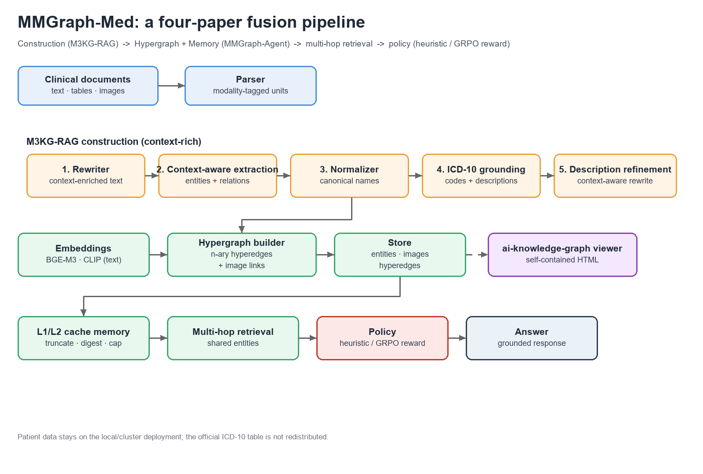

# MMGraph-Med — A Four-Paper Fusion for Chinese Clinical Multimodal RAG

An **independent engineering fusion** of four lines of work:

1. **MMGraph-Agent** (NeurIPS 2026) — cache-inspired multimodal knowledge
   hypergraphs, L1/L2 memory, GRPO retrieval-and-answer policy.
2. **M³KG-RAG** (CVPR 2026) — context-enriched triple extraction, external
   knowledge grounding, context-aware description refinement, inspector.
3. **ai-knowledge-graph** (Apache-2.0) — hybrid extraction and interactive
   knowledge-graph visualization.
4. **Multi-hop retrieval** (shared-entity / NSCLQ-style expansion) — retrieval
   that walks from one evidence block to related ones through shared entities.

The goal is not to re-publish any single paper. The goal is a **single, runnable
pipeline** that takes Chinese clinical multimodal documents, builds a grounded
hypergraph, keeps retrieval context bounded, and can host a retrieval-and-answer
policy — with every component inspectable and testable.

> **Project intent (read first).** This repository is a **methodological framework**
> for a future hospital cohort (heart failure / cardiomyopathy, malignant
> ventricular arrhythmia, multimodal precursor signals, RAG-LLM warning agent).
> Public-data and synthetic experiments — including all SFT/GRPO numbers — are
> **engineering checks**, not clinical evidence. The hospital data will be added
> only after ethics approval; the code is designed so that swapping the corpus,
> QA and labels requires configuration changes, not rewrites. See
> [docs/PROJECT_CHARTER.md](docs/PROJECT_CHARTER.md).
>
> **Status: research prototype / fusion reproduction.**
> Construction, memory, retrieval and grounding are implemented and validated on
> a small de-identified pilot. **GRPO training, pixel-level image embeddings and
> clinical evaluation are not finished.** Numbers below are engineering
> validation, not paper results.
>
> **Working project name: MMGraph-Med.** It is deliberately neutral so the
> repository does not imply official code of any paper; attribution to
> MMGraph-Agent / M³KG-RAG / ai-knowledge-graph remains in
> [Attribution](#11-attribution-and-compliance). See
> [docs/PUBLIC_DATASETS.md](docs/PUBLIC_DATASETS.md) for public datasets that
> are actually reachable from mainland China (open PhysioNet data works; MIMIC
> and other credentialed PhysioNet datasets are blocked).

[](LICENSE)


---

## 1. Why four papers, and how they fit together

| Work | Core idea | What this repo adopts | Status |
| --- | --- | --- | --- |
| **MMGraph-Agent** | zero-API multimodal hypergraph + L1/L2 cache memory + GRPO policy | n-ary hyperedges, image linking, two-tier memory, action space, GRPO reward | hypergraph ✅ · memory ✅ · reward ✅ · **GRPO training 🟡 (SFT 0.63; GRPO no gain yet)** |
| **M³KG-RAG** | rewriter → normalizer → grounding → selector/refiner → inspector | all four construction stages, dictionary-first ICD-10 grounding, batched calls | rewriter ✅ · grounding ✅ · refinement ✅ · inspector 🟡 (off by default) |
| **ai-knowledge-graph** | hybrid extraction + interactive graph viewer | pluggable regex/spaCy/LLM extraction, self-contained HTML hypergraph viewer | extraction ✅ · viewer ✅ · Neo4j/GraphML export ❌ |
| **Multi-hop retrieval** | follow shared entities to related evidence | `Store.neighbor_hyperedges` + `[retrieval].hops` | deterministic hops ✅ · adaptive sampling/pruning ❌ |



*Vector version: [architecture.svg](docs/assets/architecture.svg).*

The pipeline is the fusion point:

```text
raw clinical docs (text / tables / images)
        │
        ▼
[M3KG] rewrite ──► context-aware LLM extraction ──► normalize
        │                                           │
        │                         ICD-10 grounding + description refinement
        ▼                                           ▼
[MMGraph] parse modality units ──► entity / unit embeddings ──► n-ary hyperedges
        │                                           │
        ▼                                           ▼
[ai-knowledge-graph] interactive viewer      Store (entities, images, hyperedges)
                                                    │
                                                    ▼
                    [MMGraph] L1/L2 cache memory ◄──┘
                                │
                    multi-hop retrieval (shared entities)
                                │
                                ▼
                    policy: heuristic / GRPO reward ──► answer
```

**Design principles**

- **Pluggable components** — parser, embedder, extractor, captioner, knowledge
  searcher and policy are all swappable through TOML.
- **Local-first privacy** — the main clinical path runs against a local
  OpenAI-compatible server (Qwen2.5-7B + BGE-M3); no patient text leaves the
  cluster.
- **Graceful degradation** — every heavy dependency has a CPU fallback
  (regex parser, hashing embedder), so the smoke pipeline runs with NumPy only.
- **Dictionary-first grounding** — when an ICD-10 entry matches, the dictionary
  wins over the LLM description.
- **Tested core** — 76 stdlib unit tests, no GPU required.

---

## 2. What is actually implemented

### 2.1 Construction (M³KG-RAG inspired)

| Stage | Implementation | Notes |
| --- | --- | --- |
| Rewriter | `hypergraph/construction.py::rewrite` | one LLM call per document, context-enriched text |
| Context-aware extraction | `hypergraph/llm_extractor.py` | extraction prompt receives the rewritten context; disk cache |
| Normalizer | `construction.py` + ICD-10 dictionary | dictionary-first, LLM fallback, batched |
| External grounding | `hypergraph/knowledge_searcher.py` | local glossary · Chinese Wikipedia · **official 6-digit ICD-10** |
| Selector / refiner | `construction.py` | batched candidate selection + context-aware rewrite |
| Inspector | `construction.py` (optional) | 0–10 scoring, drops weak descriptions; **off by default** |
| Post-processing | `builder.py` | entity-name filter, duplicate merge, hyperedge remap |

### 2.2 Hypergraph and memory (MMGraph-Agent inspired)

- **Modality units**: text sentences, markdown tables, diagrams, images.
- **n-ary hyperedges**: each text/table/diagram unit becomes a hyperedge with its
  entities, relations, linked images and embedding.
- **L1/L2 memory**: `memory/cache.py` — L2 is the persistent store, L1 is the
  per-trajectory cache; evidence is truncated to `L_max`, digested to `L_dig`,
  and capped by `L_cap`.
- **Multi-hop**: `Store.neighbor_hyperedges(edge_ids, hops)` expands through
  shared entities before memory admission.

### 2.3 Policy and evaluation

- **Action space**: text search / image search / answer (`policy/actions.py`).
- **Heuristic policy**: deterministic CPU stand-in that exercises the same action
  space (`policy/infer.py`).
- **GRPO reward**: paper Eq. (6) — token-F1 × concave call-count regulator,
  structural penalty (`policy/grpo.py::compute_reward`).
- **GRPO training**: `GRPOTrainer.train()` is an explicit **TODO stub**; the
  script prints a reward sanity check and exits (`scripts/train_grpo.py`).
- **Metrics**: token-F1, exact match, answer-in-context recall
  (`eval/metrics.py`), plus a retrieval-focused evaluator
  (`scripts/eval_retrieval.py`).

### 2.4 Operations

- Local OpenAI-compatible server for Qwen2.5-7B + BGE-M3
  (`scripts/serve_local.py`; no vLLM, no Ollama required).
- Cluster profiles: `configs/cluster_local.toml`, `configs/patient_construction.toml`.
- Windows one-click launchers: `connect_cluster.bat`, `cluster_build.bat`,
  `cluster_status.bat`.
- ICD-10 import: `scripts/import_icd10.py` (official 6-digit Excel/CSV),
  `scripts/fetch_icd10.sh` (public 3-digit fallback).

---

## 3. Validated results (small pilot, engineering validation only)

**Corpus**: 2 de-identified PCI cases → 24 chapter documents, 57 tables.
**Build profile**: local Qwen2.5-7B + BGE-M3 + M³KG construction + official
6-digit ICD-10 (35,862 entries).

| Metric | Value |
| --- | --- |
| Entities | **1,156** |
| Hyperedges | **930** |
| Duplicate entity names | **0** |
| Entities with ICD-10 code | **66** |
| Unique ICD-10 codes | **56** |
| Sample codes | `I25.103` 冠心病 · `I21.401` NSTEMI · `I50.900` 心衰 · `E11.900` 2型糖尿病 · `I69.300x002` 陈旧性脑梗死 |

**Retrieval pilot** (6 documents, 12 hand-written QA):
`answer-in-context recall = 0.833`. This is a smoke check, not a benchmark.

> These are **not** paper results: no GRPO training, no full datasets, no
> baselines/ablations yet.

---

## 4. Repository layout

```text
src/mmgraph_agent/
  hypergraph/    parser.py encoder.py builder.py store.py captioner.py
                 llm_extractor.py construction.py knowledge_searcher.py
  memory/        cache.py
  retrieval/     retriever.py
  policy/        actions.py infer.py grpo.py
  eval/          datasets.py metrics.py runner.py validation.py
  viz/           hypergraph_view.py
  config.py utils.py cli.py http_utils.py
configs/         default/smoke/smoke_zh/cluster/adapted/local/ollama
                 cluster_local/patient_construction/patient_construction6
data/smoke/      synthetic multimodal corpus + QA
data/smoke_zh/   Chinese clinical-style demo corpus
data/icd10/      diseases.sample6.json (demo only); official table is NOT committed
scripts/         build_hypergraph.py run_smoke.py evaluate.py render_hypergraph.py
                 serve_local.py eval_retrieval.py import_icd10.py fetch_icd10.sh
                 check_api.py validate_data.py check_gpu.py train_grpo.py
                 cluster_session.sh cluster_build.sh cluster_status.sh
tests/           76 stdlib unit tests
docs/            PROJECT_CHARTER.md REPRODUCTION.md DATA_SCHEMA.md CLUSTER_SETUP.md
                 API_CHOICES.md LOCAL_DEPLOYMENT.md M3KG_CONSTRUCTION.md
                 KNOWLEDGE_GROUNDING.md MEDICAL_TERMINOLOGY.md PUBLIC_DATASETS.md
                 PUBLIC_PILOT.md GRPO.md CLINICAL_SCHEMA.md CLINICAL_EVALUATION.md
                 IMAGE_MODALITY.md RISK_MODEL_ROADMAP.md STRUCTURED_FEATURES.md
                 FEATURE_EXTRACTION.md CRF_MAPPING.md MAARS_REPRODUCTION_AUDIT.md
                 MULTIMODAL_PIPELINE.md
docs/assets/     architecture.png / architecture.svg
```

---

## 5. Quick start

### 5.1 CPU smoke (no model download)

Requires Python ≥ 3.11 and NumPy.

```bash
python -m pip install -e .          # or set PYTHONPATH=src
python scripts/run_smoke.py --verbose
python -m unittest discover -s tests
```

Expected smoke output:

```text
store: 20 entities, 4 images, 14 hyperedges
token_f1: 1.00
answer_recall: 0.875
avg_rounds: 1.125
```

### 5.2 Local models (cluster / private deployment)

```bash
# terminal 1: serve Qwen2.5-7B + BGE-M3
python scripts/serve_local.py \
  --llm /path/to/Qwen2.5-7B-Instruct \
  --embed /path/to/bge-m3 \
  --port 18000 --llm-gpu 0 --embed-gpu 1

# terminal 2: build with the local profile
PYTHONPATH=src python scripts/build_hypergraph.py \
  --config configs/cluster_local.toml \
  --data-root data/smoke_zh \
  --out out/mmkg_local.json
```

`configs/patient_construction.toml` enables all M³KG stages plus ICD-10 grounding.

### 5.3 ICD-10 terminology

The official 6-digit national clinical version is hospital-authorized and is
**not redistributed** in this repository. Import your own file:

```bash
python scripts/import_icd10.py \
  --input "国家临床版2.0疾病诊断编码.xlsx" \
  --out data/icd10/diseases.json
```

```toml
[grounding]
searcher = "icd10"
icd10_path = "data/icd10/diseases.json"
```

A public 3-digit fallback can be downloaded with `scripts/fetch_icd10.sh`;
`data/icd10/diseases.sample6.json` is a tiny demo table for tests.

### 5.4 Windows one-click

Double-click `connect_cluster.bat` to open a cluster workspace with `build` /
`status` / `exit` helpers; `cluster_build.bat` and `cluster_status.bat` run the
two actions directly.

### 5.5 Public ECG pilot (no hospital data)

[`docs/PUBLIC_PILOT.md`](docs/PUBLIC_PILOT.md) builds a 360-window VFDB pilot
(`pre` / `va` / `baseline`) + 300 PTB-XL documents, then runs the same
hypergraph + memory pipeline. With the local BGE-M3 embedder the 60-question
retrieval smoke test reaches **0.933** answer-in-context recall (hashing
baseline: 0.033). This is an engineering check, not an arrhythmia-prediction
result.

### 5.6 Structured feature extraction + review

Reports (echo/ECG/CTA/CMR) are first-class text: no video frame extraction is
needed for report-based inputs. The prototype converts Chinese reports into a
computable variable table with provenance:

```bash
python scripts/make_report_demo.py

# rules only
python scripts/extract_clinical_features.py \
    --reports data/clinical_demo/reports.jsonl --out-dir out/clinical_features

# rules + local LLM fallback (strictly evidence-checked)
python scripts/extract_clinical_features.py \
    --reports data/clinical_demo/reports.jsonl \
    --out-dir out/clinical_features_llm --use-llm --config configs/cluster_local.toml

# human review sheet + field-level scoring
python scripts/make_review_sheet.py \
    --features out/clinical_features_llm/features.jsonl \
    --out out/clinical_features_llm/review_sheet.csv --max 50
python scripts/score_extraction.py \
    --features out/clinical_features_llm/features.jsonl \
    --review out/clinical_features_llm/review_sheet.csv \
    --out out/clinical_features_llm/review_metrics.json
```

Rules handle units (cm→mm), negation ("未见"), uncertainty ("可疑"), explicit
missing and provenance. The LLM fallback fills only `missing`/`uncertain`
variables and every value must be supported verbatim by the report text; in the
5-report demo it filled only `age` (5/5) and produced **no hallucinated
negatives**. See [docs/FEATURE_EXTRACTION.md](docs/FEATURE_EXTRACTION.md).

### 5.7 GRPO training (SFT warm-up + GRPO)

[`docs/GRPO.md`](docs/GRPO.md) describes the functional single-GPU loop:
retrieval environment, SFT warm-up on legal `<search>/<answer>` trajectories,
group-relative advantage, ratio clipping, KL to a frozen reference, LoRA.

On the same 84 held-out prompts (group-aware split, no record/patient leakage,
7 question categories, greedy decoding):

| Policy | exact | token-F1 |
| --- | --- | --- |
| base Qwen2.5-7B | 0.214 | 0.258 |
| + SFT warm-up | 0.631 | 0.738 |
| + GRPO 100 steps, lr 5e-5 | 0.536 | 0.661 |
| + GRPO 30 steps, lr 1e-5, β 0.1 | 0.631 | 0.738 |

**Honest finding:** SFT is the main driver; high-LR GRPO collapses, stabilised
GRPO is flat. On this data/reward GRPO does **not yet** beat SFT. The algorithm
is implemented and trainable; the next step is better reward/task design, not
more steps.

```bash
python scripts/make_public_qa.py --limit 12000          # 6354 / 846 group-aware
PYTHONPATH=/path/to/pylibs python scripts/sft_warmup_public.py \
    --limit 500 --steps 300 --device cuda:2
PYTHONPATH=/path/to/pylibs python scripts/train_grpo_public.py \
    --init-adapter /path/to/public_pilot/sft_adapter \
    --steps 10 --group-size 2 --limit 32 --eval-limit 16 --device cuda:2
```

### 5.8 Clinical schema and warning evaluation (hospital-data ready)

The framework now includes the bridge to the future hospital cohort:

- [`docs/CLINICAL_SCHEMA.md`](docs/CLINICAL_SCHEMA.md) — patient × time-window
  JSON (EMR/ECG/echo/CMR/labs/meds/notes), event labels (`VT`/`VF`/`SCD`/
  `ICD_shock`), label rules (pre-event window vs negative vs excluded),
  de-identification rules;
- [`docs/CLINICAL_EVALUATION.md`](docs/CLINICAL_EVALUATION.md) — AUROC, AUPRC,
  sensitivity at fixed specificity, PPV/NPV, Brier/ECE, lead time, bootstrap CI,
  and the reporting protocol.

```bash
# validate a hospital export (only deidentified=true cases pass)
python scripts/validate_clinical_data.py --cases data/clinical_demo/cases.jsonl

# convert cases to the existing RAG corpus
python scripts/build_clinical_corpus.py \
    --cases data/clinical_demo/cases.jsonl --out-root out/clinical_demo_corpus

# warning metrics (synthetic demo; no clinical claim)
python scripts/eval_clinical.py --synthetic 400 --out out/clinical_eval.json
```

The demo cases are **synthetic**; the metrics harness is validated on synthetic
data only until the hospital cohort arrives.

### 5.9 Image modality (CLIP pixel vectors)

[`docs/IMAGE_MODALITY.md`](docs/IMAGE_MODALITY.md) explains the image adapter.
Each image unit now stores both a **caption embedding** (text space, used by the
existing retrieval) and a **CLIP pixel vector** (`image_embedding`, 512-d) in the
same record. Paths are resolved against `--data-root`; missing files fall back to
caption-only.

```toml
[image]
embedder = "clip"          # none | clip
model = "openai/clip-vit-base-patch32"
dim = 512
device = "cpu"
```

```bash
# local snapshot via env (no absolute path in the repo)
export MMGRAPH_CLIP_MODEL=/path/to/clip-vit-base-patch32
python scripts/build_hypergraph.py --config configs/image_clip.toml \
    --data-root data/smoke_zh --out out/smoke_zh_clip.json
```

Verified on `data/smoke_zh`: 3 image units, 1 with a real file got
`image_embedder=clip, image_dim=512`; the other two fell back to captions.

**Cross-modal retrieval** (`[retrieval].cross_modal = true`): the memory now
encodes the query with CLIP and fuses `Store.search_images_clip` hits with the
text/hypergraph evidence. On a 6-image synthetic demo:

| encoder | CLIP hit@1 | caption baseline hit@1 |
| --- | --- | --- |
| OpenAI CLIP | 1.00 | 0.667 |
| **Chinese-CLIP** | **1.00** | 0.167 |

**Chinese-CLIP** is supported via `[image].embedder = "chinese-clip"`; the
adapter was verified with a local `OFA-Sys/chinese-clip-vit-base-patch16`
snapshot. See [docs/IMAGE_MODALITY.md](docs/IMAGE_MODALITY.md) for download and
config details.

### 5.10 CRF variable table and mapping

[`docs/CRF_MAPPING.md`](docs/CRF_MAPPING.md) defines a MAARS-aligned CRF draft
(57 variables: EHR 25, CIR 16, ECG 5, CMR 1, OUTCOME 7, META 3) and maps each
variable to its `CLINICAL_SCHEMA` path, extraction variable and MAARS branch.

```bash
python scripts/export_crf.py \
    --crf configs/crf_variables.json \
    --out-dir data/crf \
    --cases data/clinical_demo/cases.jsonl
```

Outputs: `crf_variable_dictionary.csv` (clinical team), `crf_form_template.csv`,
`crf_mapping.json` and `crf_demo_rows.csv` (synthetic demo rows).

### 5.11 MAARS audit and the complete multimodal ML pipeline

Two methodology notes:

- [`docs/MAARS_REPRODUCTION_AUDIT.md`](docs/MAARS_REPRODUCTION_AUDIT.md) — a
  line-by-line audit of the MAARS Methods (3D-ViT, EHR/CIR FNN branches, MBT
  fusion, focal loss, 5-fold/external validation, SHAP/attention rollout) and
  the honest current status: the risk-model algorithm is **not yet
  reproduced** (≈0–10%); only the data/extraction/metrics layers exist.
- [`docs/MULTIMODAL_PIPELINE.md`](docs/MULTIMODAL_PIPELINE.md) — the full
  pipeline from local clinical database to risk stratification: labels,
  de-identification, CRF, preprocessing, patient-level splits, baseline
  skeleton (Logistic/GBDT), early/late/intermediate fusion, calibration,
  external validation, interpretability and deployment.

For a text-first design (EHR + echo/ECG/CTA/CMR reports, no raw image
analysis), skip the LGE-CMR 3D-ViT branch and reproduce the EHR + CIR branches
plus fusion; this is a "MAARS-inspired" model, not a full MAARS reproduction.

---

## 6. Input format

Corpus (JSONL, one document per line):

```json
{"doc_id": "p0001-s01", "text": "……",
 "images": [{"image_id": "p0001-s06_img1", "caption": "心电图波形", "path": "images/0001_06_1.jpg"}],
 "tables": [{"table_id": "p0001-s01_t1", "text": "项目 | 内容\n……"}],
 "diagrams": []}
```

QA (JSONL): `{"qid", "question", "answer", "has_image"}`.

See [docs/DATA_SCHEMA.md](docs/DATA_SCHEMA.md).

---

## 7. Configuration cheat sheet

```toml
[hypergraph]
parser = "regex"       # auto | spacy | regex
embedder = "api"       # auto | hashing | clip | api
embed_dim = 1024

[extractor]
mode = "llm"           # regex | llm | auto
base_url = "http://127.0.0.1:18000/v1/chat/completions"
model = "qwen2.5-7b"

[construction]
enabled = true         # M³KG four stages
rewriter = true
grounding = true
refinement = true
inspector = false

[grounding]
searcher = "icd10"     # none | local | wikipedia | icd10
icd10_path = "data/icd10/diseases.json"

[memory]
C = 5; L_max = 1200; L_dig = 300; L_cap = 5000

[retrieval]
hops = 1               # multi-hop expansion depth
```

---

## 8. What is *not* done yet (honest list)

- **GRPO training** — a functional single-GPU LoRA trainer is implemented and
  smoke-tested (see [docs/GRPO.md](docs/GRPO.md)); the paper's distributed
  Qwen2.5-VL-3B recipe is **not reproduced**.
- **Pixel-level image vectors** — images currently enter the graph as caption
  text + text embeddings. A CLIP image encoder is not wired into the builder.
- **Clinical evaluation** — no cohort, no VT/VF/SCD labels, no AUROC /
  sensitivity / lead-time metrics; only token-F1 and answer recall.
- **Baselines and ablations** — no vanilla-RAG, no-memory, no-construction
  comparison yet.
- **Full 23 datasets / three regimes** — only smoke + a small de-identified
  pilot.
- **Exports** — no Neo4j/Cypher/GraphML/CSV export yet.
- **Inspector** — implemented but disabled; not validated.

---

## 9. Roadmap

- [x] CPU smoke + unit tests
- [x] M³KG construction stages (rewriter / grounding / refinement)
- [x] ICD-10 grounding (public 3-digit + official 6-digit importer)
- [x] L1/L2 memory + deterministic multi-hop
- [x] Duplicate-entity merge, Chinese sentence splitting, batched LLM calls
- [x] GRPO training loop (7B text + LoRA smoke) · [ ] paper-scale Qwen2.5-VL-3B
- [x] Clinical schema (patient × time-window) + warning metrics harness (synthetic-validated)
- [x] Structured variable extraction prototype (units, negation, uncertainty, provenance)
- [x] LLM fallback + review sheet/scoring tooling (synthetic-validated)
- [x] CRF variable table/mapping (57 vars, MAARS-aligned draft v0.1)
- [ ] Human double review on hospital reports (P1)
- [x] CLIP pixel vectors for image units (caption-space retrieval preserved; see [docs/IMAGE_MODALITY.md](docs/IMAGE_MODALITY.md))
- [x] CLIP text→image cross-modal retrieval fused into memory (hit@1 1.00 vs caption 0.667)
- [x] Chinese-CLIP adapter (`chinese-clip`, hit@1 1.00 on Chinese queries)
- [ ] Expanded QA + token-F1/EM + baselines/ablations (P1)
- [ ] AUROC / sensitivity / lead time on a labeled hospital cohort (P2)
- [ ] Neo4j/Cypher export and graph-chat (P2)

---

## 10. Limitations

- This is **not** the official implementation of any of the four works; it is an
  independent fusion for Chinese clinical data.
- The main clinical path uses an **adapted** local LLM + embedding stack, not the
  paper's zero-API frozen-CLIP pipeline; the zero-API fallbacks remain available
  for CPU smoke.
- The pilot uses 2 de-identified PCI cases; it is not the target heart-failure /
  ventricular-arrhythmia cohort, and no clinical conclusion should be drawn.
- The public ICD-10 fallback is a 3-digit category list; the official 6-digit
  table must be obtained from the hospital and is not redistributed here.

---

## 11. Attribution and compliance

This project is built on top of ideas and scaffolding from:

- **[ai-knowledge-graph](https://github.com/robert-mcdermott/ai-knowledge-graph)**
  (Apache-2.0) — the text-to-knowledge-graph toolkit this work started from.
- **[M³KG-RAG](https://kuai-lab.github.io/cvpr2026m3kgrag/)** (CVPR 2026) —
  multi-hop multimodal KG construction and retrieval refinement.
- **[MMGraph-Agent](https://github.com/LHRLAB/MMGraph-Agent)** (NeurIPS 2026) —
  the cache-inspired hypergraph, memory and GRPO policy.
- Multi-hop retrieval line of work (NSCLQ-style shared-entity expansion).

**Data and terminology compliance**

- **No patient data is included.** The bundled corpora are synthetic; the
  de-identified pilot is not committed.
- The **official ICD-10 coding table is hospital-authorized** and excluded from
  version control (`data/icd10/` is gitignored). Do not upload it to GitHub.
- Patient-derived material must stay on an approved local/cluster deployment;
  confirm with the institutional ethics committee before any external API use.

The Apache-2.0 license of the upstream is retained; see [LICENSE](LICENSE) and
[NOTICE](NOTICE).

## 12. Citation

```bibtex
@inproceedings{luo2026mmgraphagent,
  title  = {MMGraph-Agent: Agentic Multimodal RAG via Cache-Inspired Multimodal Knowledge HyperGraphs},
  author = {Luo, Haoran and Zhu, Ziyue and Wu, Shangyang and others},
  booktitle = {Conference on Neural Information Processing Systems (NeurIPS)},
  year   = {2026}
}

@inproceedings{park2026m3kgrag,
  title  = {M3KG-RAG: Multi-hop Multimodal Knowledge Graph-enhanced Retrieval-Augmented Generation},
  author = {Park, Hyeongcheol and Seo, Jiyoung and Mun, Jaewon and others},
  booktitle = {Conference on Computer Vision and Pattern Recognition (CVPR)},
  year   = {2026}
}
```

---

## 中文摘要

本仓库把四条技术线**融合成一个可运行的中文临床多模态 RAG 流水线**：

| 来源 | 采纳的核心机制 | 状态 |
| --- | --- | --- |
| MMGraph-Agent | 多模态超图、L1/L2 缓存记忆、GRPO 奖励 | 超图/记忆/奖励 ✅，GRPO 训练 ❌ |
| M³KG-RAG | 改写、上下文增强抽取、知识接地、描述精炼、自反思 | 前四项 ✅，自反思 🟡 |
| ai-knowledge-graph | 混合抽取 + 交互式可视化 | ✅（导出/推理 ❌） |
| 多跳检索 | 共享实体多跳扩展 | 确定性多跳 ✅，自适应采样 ❌ |

**已验证**：2 例脱敏 PCI 病历 → 24 篇文档 → **1156 实体 / 930 超边 / 66 个 ICD 编码实体 / 56 个唯一码**；
检索 pilot（12 题）answer recall **0.833**；76 个单测通过。

**尚未完成**：GRPO 训练（仅奖励函数+桩）、图像像素向量（当前用 caption 文本）、
临床指标（AUROC/敏感度/提前时间）、基线/消融、23 数据集。

**合规**：仓库不含患者数据；官方 6 位 ICD-10 编码表属医院授权资产，已被
`.gitignore` 排除，不随仓库分发。


